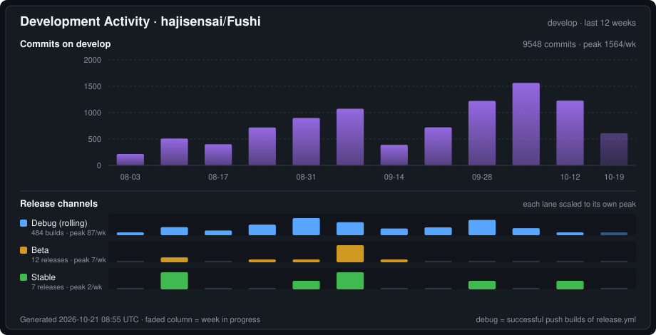
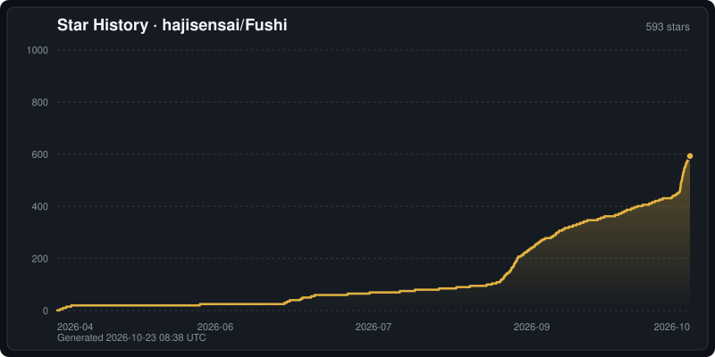

<div align="center">

# Fushi


[English](README.md) | **简体中文** | [繁體中文](docs/readme/README.zh-Hant.md) | [日本語](docs/readme/README.ja.md) | [한국어](docs/readme/README.ko.md) | [Español](docs/readme/README.es.md) | [Français](docs/readme/README.fr.md) | [Deutsch](docs/readme/README.de.md) | [Português](docs/readme/README.pt-BR.md) | [Русский](docs/readme/README.ru.md) | [Tiếng Việt](docs/readme/README.vi.md) | [ภาษาไทย](docs/readme/README.th.md) | [Bahasa Indonesia](docs/readme/README.id.md) | [Italiano](docs/readme/README.it.md) | [Nederlands](docs/readme/README.nl.md) | [Türkçe](docs/readme/README.tr.md) | [العربية](docs/readme/README.ar.md)

[](https://fushi.moe/)

[](https://fushi.moe/)
[](https://discord.gg/WhjwyGmm7f)

</div>


## 平台支持

| 平台 | 状态 | 说明 |
|---|---|---|
| Android | ✅ | Android 7.0（API 24）及以上 |
| Windows | ✅ | Galgame 文本 / 语音 Hook 仅限 Windows |
| macOS | ✅ | 仅 Apple Silicon，不支持 Intel Mac |
| iOS | ✅（[TestFlight](https://testflight.apple.com/join/j88d69jx)） | 按 App Store 审核指南不含发现、在线源与下载中心 |
| Linux | 🔧 需从源码构建 | 暂无预编译包；EPUB 阅读器需要 WPE WebKit |
| Fushi Server | 🧪 Beta（[fushi-server](https://github.com/hajisensai/fushi-server/releases)） | 无头服务端，支持 Linux / Windows / macOS，带 Web 管理界面，见 [packages/fushi_server](packages/fushi_server/README.md) |

**设计系统**：所有平台默认 **Material 3 Expressive**；可在「设置 › 外观 › 设计系统」切换为 **Cupertino**（Apple 风格）。选用 Cupertino 时，Windows 11 窗口背景使用 Mica、macOS 使用 vibrancy（系统开启「降低透明度」或「增强对比度」时除外）。

> 词典查词的语言由导入的词典与 Yomitan 变换表决定，与界面语言相互独立。iOS 版通过 TestFlight 更新，会比其他平台晚几天。

### 界面语言（17 种）

English · 简体中文 · 繁體中文 · 日本語 · 한국어 · Español · Français · Deutsch · Português (Brasil) · Русский · Tiếng Việt · ภาษาไทย · Bahasa Indonesia · Italiano · Nederlands · Türkçe · العربية

## 安装

从 [Fushi 官网](https://fushi.moe/) 下载最新版本，提供 Android APK、Windows 安装包与 macOS 构建（仅 Apple Silicon，不支持 Intel Mac）；iOS 通过 [TestFlight](https://testflight.apple.com/join/j88d69jx) 安装。Linux 暂无预编译的 App 安装包，需自行从源码构建。无头服务端 Fushi Server 单独在 [hajisensai/fushi-server](https://github.com/hajisensai/fushi-server/releases) 发布。

> 最低 Android 7.0（API 24）。

## 构建

一键准备（`flutter pub get` + 打补丁），然后构建：

```bash
# 在仓库根目录
bash tool/bootstrap.sh          # Windows PowerShell：.\tool\bootstrap.ps1

cd fushi
# Android
flutter build apk --release --target-platform android-arm64 --split-per-abi
# 桌面
flutter build windows --release
flutter build macos --release
flutter build linux --release
# iOS
flutter build ipa --release

# 无头服务端（在 packages/fushi_server 下；用 `dart build cli`，不要用 `dart compile exe`）
dart build cli
```

`tool/bootstrap.sh` / `tool/bootstrap.ps1` 把 `flutter pub get` 与 `ci/apply-patches.sh` 收敛成一条命令。本项目锁定 Flutter 3.47.6（Dart SDK `>=3.8.0 <4.0.0`）；Material 与 Cupertino 改走 `material_ui` / `cupertino_ui` 包，更早的 Flutter 版本编译不过。部分上游依赖经 vendored 到 `third_party/` 或由 `ci/apply-patches.sh` 修补——机制细节与 Linux 桌面构建依赖见 [docs/agent/build.md](docs/agent/build.md)。

<details>
<summary><b>技术栈一览</b></summary>

| 层 | 技术 |
|---|---|
| 框架 | Flutter 3.47.6（Dart SDK `>=3.8.0 <4.0.0`），Riverpod |
| 平台 | Android / Windows / macOS / iOS / Linux，外加无头服务端 |
| UI | `material_ui`（Material 3 Expressive）/ `cupertino_ui`（Cupertino） |
| 阅读器 | WebView 分页引擎（衍生自 Hoshi Reader 系列） |
| 视频 | media_kit（libmpv 内核）+ libplacebo |
| 存储 | Drift（SQLite，WAL）+ fushidicts（C++ FFI 词典引擎） |
| NLP | Yomitan 变换表（多语言词形还原）+ kana_kit（假名转换）；分词走 fushidicts FFI |
| 端上 AI | ONNX Runtime 跑语音识别（生成字幕）与漫画 OCR；算法在 [fushi-subtitles](https://github.com/hajisensai/fushi-subtitles) |
| 下载 | libtorrent 2.x（C ABI FFI 桥），外接 qBittorrent 兜底 |
| 同步 | 云端后端 + Fushi Interconnect（局域网、远程地址、iroh P2P 隧道） |
| 共享引擎 | `fushi_engine`：App 与 Fushi Server 共用的纯 Dart 核心 |
| 制卡 | AnkiDroid API + AnkiConnect |
| 国际化 | Slang（17 种语言） |

</details>

<details>
<summary><b>项目结构</b></summary>

```
Fushi/                      # 仓库根（Melos workspace: fushi_workspace）
├── fushi/                  # Flutter 应用主目录
│   ├── lib/
│   │   ├── i18n/            # 国际化（17 种语言，Slang）
│   │   ├── src/
│   │   │   ├── pages/       # 页面（库页、阅读器、视频播放器、设置等）
│   │   │   ├── reader/      # 阅读器 WebView JS/CSS 脚本
│   │   │   ├── media/       # 书、漫画、视频、有声书、在线源
│   │   │   ├── lookup/      # 查词弹窗与浮窗
│   │   │   ├── mining/      # 制卡（含 galgame 制卡）
│   │   │   ├── sync/        # 云同步、互联、媒体服务器
│   │   │   └── models/      # 数据模型与状态管理（AppModel）
│   │   └── main.dart
│   └── android/             # Android 工程
├── packages/                # Dart 包
│   ├── fushi_core/          #   数据库 schema、偏好
│   ├── fushi_engine/        #   与服务端共用的纯 Dart 引擎
│   ├── fushi_server/        #   无头服务端 CLI + Web 界面
│   ├── fushi_cli/           #   桌面命令行客户端
│   ├── fushi_dictionary/    #   词典引擎绑定与导入
│   ├── fushi_anki/ · fushi_audio/ · fushi_platform/ · fushi_srs/
│   ├── fushi_torrent/ · fushi_p2p/   # libtorrent / iroh FFI 绑定
│   └── …                    #   vendored fork（inappwebview Windows/Linux、gamepads）
├── native/                  # 原生源码：fushidicts、fushi_torrent、fushi_p2p（Rust）、galgame_hook 等
├── services/                # 日志接收端与排行榜后端（独立部署）
├── tools/browser-extension/ # 浏览器查词扩展
├── third_party/             # vendored 补丁包（dependency_overrides 指向）
├── ci/                      # 构建补丁与 CI 脚本
├── tool/                    # bootstrap / setup_worktree / bug 记录等脚本
└── docs/                    # 开发文档（含 docs/agent/ agent 操作手册）
```

</details>

视频导入支持按作品或文件夹分组。使用方式见[视频组织与刮削流程](docs/specs/2026-09-07-video-library-workflow.md)及[MAL/TMDB 资料与 AniDB 文件哈希识别](docs/specs/2026-09-07-mal-tmdb-anidb-hash.md)。

## 隐私与数据

Fushi 将导入的书籍、词典、字体、有声书数据、视频、阅读进度、高亮、统计和设置保存在 App 本地存储中。

- **同步**：Google Drive / OneDrive / Dropbox 走 OAuth 登录；WebDAV / FTP / SFTP / Fushi Server 使用你提供的服务器地址与凭据。Fushi Interconnect 在已配对设备间直连（局域网、IPv6、组网或公网地址），直连全部失败时退到端到端的 iroh P2P 隧道；配对链接一律先弹确认。
- **Anki**：制卡只与 AnkiDroid 或你配置的 AnkiConnect 地址通信。
- **使用统计**：桌面端与 Android 每天最多一次，向 fushi.moe 发送随机安装 ID、App 版本、平台与更新通道，用于统计活跃用户；不含账户、书库或阅读数据，服务端不存 IP。可在更新设置里关闭「发送使用统计」。iOS 不发送。
- **仅在你主动操作时**：日志上传（首次需确认同意）、应用内反馈、排行榜（默认关闭；开启并同意后才上传书架标题与进度）。
- **漫画 OCR**：默认引擎是 Google Lens，会把页面图片发给 Google；想让图片留在本机，请在设置里改用端上模型或系统 OCR。
- **AI 功能**：只向你配置并指派给该功能的 LLM 提供商发请求；未指派时不发送任何请求。
- **第三方服务**：元数据、字幕与在线源功能只在使用时访问[内容源与集成](#内容源与集成)中列出的服务。

## 开发活跃度

[](https://github.com/hajisensai/Fushi/commits/develop)

日常开发都提交在 `develop`，`main` 只接收发布合并。上图虽然显示在 `main` 上，数据取自 `develop`，所以反映的是真实开发量，而不是合并流水。

下方三条泳道就是 App 内提供的三个更新通道，每条按各自峰值缩放——debug 构建数比正式版高两个数量级，用同一把标尺会把后两条压成看不见。

| 泳道 | 统计对象 | 获取方式 |
|---|---|---|
| **Debug（滚动）** | [release.yml](.github/workflows/release.yml) 中成功的 push 构建 | 滚动预发布，每次 push 覆盖重发 |
| **Beta** | `v<版本>-beta.<seq>` 预发布 | 手动触发的测试版 |
| **Stable** | `v<版本>` 正式发布 | 正式版（Latest） |

> 上图由本仓库内的脚本自动生成（不依赖任何第三方服务），并由 [Update Dev Activity Chart](.github/workflows/dev-activity.yml) 工作流每日刷新。

## Star 趋势

[](https://github.com/hajisensai/Fushi/stargazers)

[](https://github.com/hajisensai/Fushi/stargazers)

> 上图由本仓库内的脚本自动生成（不依赖任何第三方服务），并由 [Update Star History](.github/workflows/star-history.yml) 工作流每日刷新。

## 鸣谢

Fushi 基于以下项目与生态：

### 学习工具与前作参考

| 项目 | 说明 |
|---|---|
| [jidoujisho](https://github.com/arianneorpilla/jidoujisho) | 日语沉浸式学习工具 |
| [Hoshi Reader](https://github.com/Manhhao/Hoshi-Reader) | iOS 日语阅读器，阅读器分页引擎参考 |
| [Hoshi Reader Android](https://github.com/HuangAntimony/Hoshi-Reader-Android) | Android 原生日语阅读器 |
| [hoshidicts](https://github.com/Manhhao/hoshidicts) | C++ 词典引擎 |
| [Sasayaki](https://github.com/Manhhao/Hoshi-Reader/blob/develop/SASAYAKI.md) | 有声书同步方案 |
| [Tsubasa](https://github.com/SonicSandbox/Tsubasa-sync) | 字幕按参考轨对时间轴的算法（GPL-3.0）；下载字幕按内嵌轨自动对齐的算法参照 |
| [Yomitan](https://github.com/yomidevs/yomitan) | 词典格式、变换表与查词体验参考 |
| [Lapis](https://github.com/donkuri/lapis) | Anki 笔记类型 |
| [AnkiDroid](https://github.com/ankidroid/Anki-Android) | Android 制卡集成 |
| [Ankiconnect Android](https://github.com/KamWithK/AnkiconnectAndroid) | 本地音频与 AnkiDroid 交互参考 |
| [ッツ Ebook Reader](https://github.com/ttu-ttu/ebook-reader) | 阅读器、统计与同步兼容性参考 |
| [media_kit](https://github.com/media-kit/media-kit) | Flutter 视频播放框架（libmpv 内核） |
| [Niratan](https://github.com/W1ght/Niratan) | macOS 沉浸式语言学习套件 |

### 引擎与原生组件

| 项目 | 说明 |
|---|---|
| [LunaHook](https://github.com/HIllya51/LunaTranslator) | galgame 文本 hook 引擎（vendored DLL，由注入器加载） |
| [MinHook](https://github.com/TsudaKageyu/minhook) | galgame 注入器使用的 inline hook 库 |
| [libtorrent](https://github.com/arvidn/libtorrent) | 内置 torrent 下载引擎 |
| [mpv](https://github.com/mpv-player/mpv) | media_kit 背后的 libmpv 播放内核 |
| [FFmpeg](https://ffmpeg.org) | 媒体探测、切片与音频抽取 |
| [libplacebo](https://github.com/haasn/libplacebo) | GPU 视频着色器与 HDR 色调映射 |
| [flutter_inappwebview](https://github.com/pichillilorenzo/flutter_inappwebview) | 渲染 EPUB 阅读器的 WebView 引擎 |
| [ONNX Runtime](https://github.com/microsoft/onnxruntime) | 语音识别与 OCR 的端上推理 |
| [iroh](https://github.com/n0-computer/iroh) | Fushi Interconnect 远程连接用的 P2P 隧道 |
| [zstd](https://github.com/facebook/zstd) · [xxHash](https://github.com/Cyan4973/xxHash) · [libdeflate](https://github.com/ebiggers/libdeflate) · [glaze](https://github.com/stephenberry/glaze) · [unordered_dense](https://github.com/martinus/unordered_dense) · [utf8proc](https://github.com/JuliaStrings/utf8proc) · [utfcpp](https://github.com/nemtrif/utfcpp) | 词典引擎依赖 |

### 端上模型

| 项目 | 说明 |
|---|---|
| [sherpa-onnx](https://github.com/k2-fsa/sherpa-onnx) | Zipformer 语音识别模型包与 VAD 构建 |
| [ReazonSpeech k2-v2](https://huggingface.co/reazon-research/reazonspeech-k2-v2) | 日语语音识别模型 |
| [Parakeet TDT-CTC 0.6B ja](https://huggingface.co/nvidia/parakeet-tdt_ctc-0.6b-ja) | 日语语音识别模型 |
| [Kitsune](https://huggingface.co/subthx/kitsune-onnx) | 日语语音识别模型（CC BY-NC 4.0，从其 Hugging Face 仓库直接下载） |
| [Omnilingual ASR](https://github.com/facebookresearch/omnilingual-asr) | 多语言 CTC 语音识别模型 |
| [Silero VAD](https://github.com/snakers4/silero-vad) | 人声活动检测模型 |
| [comic-text-and-bubble-detector](https://huggingface.co/ogkalu/comic-text-and-bubble-detector) | 漫画文本与对话气泡检测模型 |
| [manga-panel-detector-yolo26n](https://huggingface.co/leoxs22/manga-panel-detector-yolo26n) | 漫画分格检测模型，基于 [Manga109-s](http://www.manga109.org/en/download_s.html) 训练 |
| [PP-OCRv6](https://github.com/PaddlePaddle/PaddleOCR) small det / rec · [PP-OCRv6_manga](https://huggingface.co/Kellenok/PP-OCRv6_manga) | 文本行检测与识别；漫画调优的 rec（以 [Manga109-s](http://www.manga109.org/en/download_s.html) 与 [AnimeText](https://huggingface.co/datasets/deepghs/AnimeText) 训练）驱动逐列 CTC 本地 OCR 模型 |

> 漫画分格检测模型与 PP-OCRv6_manga 使用 Manga109-s 数据集（Matsui et al. 2017; Aizawa et al. 2020）训练，其条款要求明确标注对该数据集的使用。PP-OCRv6_manga（Apache-2.0）另以 AnimeText 数据集训练，该数据集采用 CC BY-NC-SA 4.0 许可；App 从模型的 Hugging Face 仓库下载，本项目不转发该模型。

### 内容源与集成

| 项目 | 说明 |
|---|---|
| [Mihon](https://github.com/mihonapp/mihon) | 漫画源扩展生态 |
| [Aniyomi](https://github.com/aniyomiorg/aniyomi) | 动画源扩展生态（extensions-lib 14–16，与漫画共用同一运行时） |
| [M-Extension-Server](https://github.com/kodjodevf/M-Extension-Server) | 桌面端漫画扩展运行时（vendored，MPL-2.0） |
| [Mangayomi](https://github.com/kodjodevf/mangayomi) | Mihon / Aniyomi 扩展适配参考 |
| [LNReader](https://github.com/LNReader/lnreader-plugins) | 轻小说源插件生态 |
| [Jellyfin](https://jellyfin.org) · [Emby](https://emby.media) · [Plex](https://www.plex.tv) | 可在视频库中浏览的媒体服务器 |
| [asbplayer](https://github.com/asbplayer/asbplayer) | 浏览器扩展流媒体字幕桥接参考 |
| [Shoko Server](https://github.com/ShokoAnime/ShokoServer) | 动画识别与刮削架构参考 |
| [ReinaManager](https://github.com/huoshen80/ReinaManager) | galgame 库信息架构参考 |
| [AniDB](https://anidb.net) | 动画、分集与文件身份 |
| [MyAnimeList](https://myanimelist.net)（经 [Jikan](https://jikan.moe)） | 动画元数据 |
| [TMDB](https://www.themoviedb.org) | 补充元数据与图片 |
| [VNDB](https://vndb.org) | 视觉小说元数据 |
| [Jimaku](https://jimaku.cc) | 日语字幕源 |
| [OpenSubtitles](https://www.opensubtitles.com) | 字幕源 |

> 本应用使用 TMDB 及 TMDB API，但未获得 TMDB 的认可、认证或以其他方式批准。

## 许可证

本项目基于 GNU General Public License v3.0 发布。详情见 [LICENSE](LICENSE)。

## 维护者

Fushi 由 [hajisensai](https://github.com/hajisensai) 维护。官网：[fushi.moe](https://fushi.moe)。联系：[contact@fushi.moe](mailto:contact@fushi.moe)。

<div align="center">

<br>

[English](README.md) | **简体中文** | [繁體中文](docs/readme/README.zh-Hant.md) | [日本語](docs/readme/README.ja.md) | [한국어](docs/readme/README.ko.md) | [Español](docs/readme/README.es.md) | [Français](docs/readme/README.fr.md) | [Deutsch](docs/readme/README.de.md) | [Português](docs/readme/README.pt-BR.md) | [Русский](docs/readme/README.ru.md) | [Tiếng Việt](docs/readme/README.vi.md) | [ภาษาไทย](docs/readme/README.th.md) | [Bahasa Indonesia](docs/readme/README.id.md) | [Italiano](docs/readme/README.it.md) | [Nederlands](docs/readme/README.nl.md) | [Türkçe](docs/readme/README.tr.md) | [العربية](docs/readme/README.ar.md)

</div>
